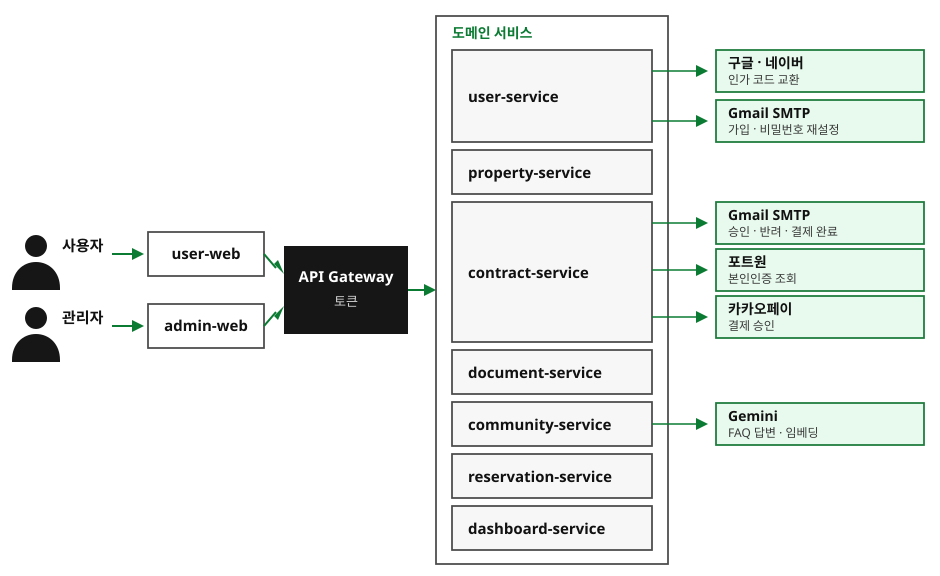
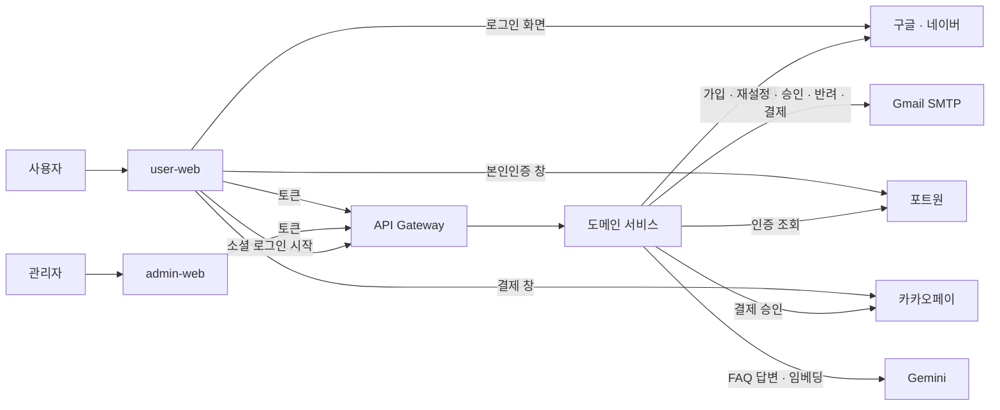
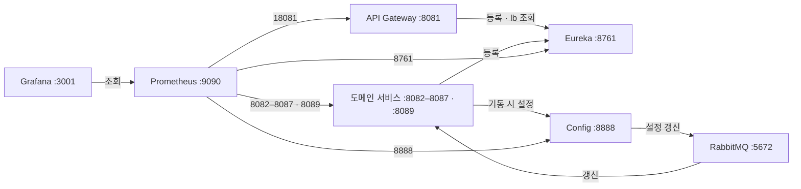
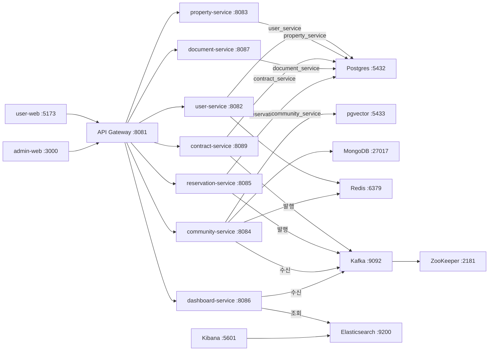
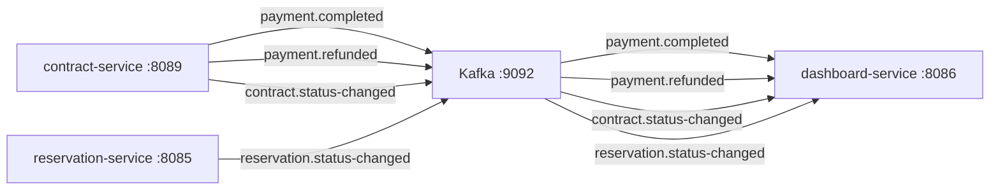
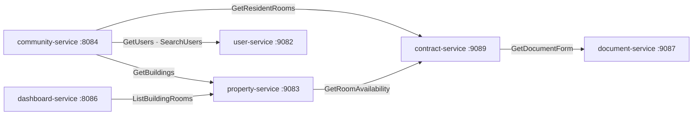

# 시스템 아키텍쳐

`compose.yaml`의 컨테이너입니다. garage(S3 호환, 발행 3900)는 로컬 전용이라 뺐습니다. Spring 서비스는 컨테이너가 아니고 호스트에서 `bootRun`합니다.

호스트는 `localhost` 발행 포트로 붙습니다. `postgres`, `kafka` 같은 컨테이너 DNS는 `coliving-platform` 네트워크 안에서만 쓰입니다.

| 컨테이너 | 이미지 | 발행 포트 | 호스트에서 쓰는 곳 |
|---|---|---|---|
| coliving-postgres | postgres:17.11-alpine | 5432 | user, property, contract, reservation, document |
| coliving-pgvector | pgvector:pg17 | 5433 | community-service FAQ 벡터 |
| coliving-mongodb | mongo:7.0.45 | 27017 | community-service |
| coliving-redis | redis:8.10.2 | 6379 | user, community |
| coliving-rabbitmq | rabbitmq:4.3.6-management | 5672, 15672 | Config Server, Spring Cloud Bus |
| coliving-zookeeper | zookeeper:3.5.9 | 2181 | Kafka만. 호스트 앱은 접속하지 않음 |
| coliving-kafka | wurstmeister/kafka:2.13-2.8.1 | 9092 | contract, reservation, dashboard. 내부 리스너는 kafka:9093 |
| coliving-elasticsearch | elasticsearch:9.4.5 | 9200 | dashboard-service |
| coliving-kibana | kibana:9.4.5 | 5601 | 사람. Elasticsearch는 컨테이너 DNS로 접속 |
| coliving-prometheus | prom/prometheus:v3.5.0 | 9090 | 호스트 actuator를 `host.docker.internal`로 스크랩 |
| coliving-grafana | grafana:12.0.0 | 3001 | 화면. compose에는 Prometheus 데이터소스 연결이 없음 |

컨테이너 사이 연결은 세 개입니다.

- Kafka → ZooKeeper `zookeeper:2181`
- Kibana → Elasticsearch `http://elasticsearch:9200`
- Prometheus → 호스트 `host.docker.internal`의 `/actuator/prometheus`

Postgres 데이터베이스 이름은 `user_service`, `property_service`, `contract_service`, `reservation_service`, `document_service`입니다. community의 관계형 데이터는 pgvector의 `community_service`입니다.

## 전체 아키텍처

사용자는 user-web을 쓰고, 관리자는 admin-web을 씁니다. 화면은 Gateway만 호출합니다. Gateway가 토큰을 확인하고, `/*/admin/**`은 `ROLE_ADMIN`입니다. 구글·네이버 로그인은 토큰이 생기기 전 경로라서 Gateway에서 인증 없이 통과하고, user-service가 인가 코드를 바꿉니다. FAQ 답변과 문서 임베딩은 community-service가 Gemini를 호출합니다. Eureka, Config, Prometheus, Grafana, 저장소·Kafka·gRPC는 아래 상세 그림에 있습니다.

## Eureka / Config / Prometheus / Grafana

Gateway와 도메인 서비스는 Eureka에 자신을 등록합니다. Gateway는 그 목록으로 서비스 주소를 찾습니다. 도메인 서비스는 기동할 때 Config에서 설정을 읽고, 설정이 바뀌면 RabbitMQ를 거쳐 다시 읽습니다. Prometheus는 이 구성요소의 `/actuator/prometheus`를 긁습니다. Gateway만 관리 포트 18081입니다. Grafana는 그 지표 화면이고 호스트 포트는 3001입니다.

## 서비스 연결

화면은 API Gateway로만 가고, Gateway가 서비스로 나눕니다. 그 아래 화살표는 서비스가 컨테이너로 붙는 방향입니다. garage는 이 연결에 없습니다. Grafana는 위 그림에 있습니다.

## Kafka / gRPC

Kafka 화살표는 토픽 이름입니다.

gRPC 화살표는 RPC 이름입니다. 포트는 서버 포트입니다.

