# 업무 흐름

[사용자 메뉴얼 시나리오 목표](user-manual.md)를 목적별 흐름으로 그린 것이다.
상태 이름은 화면에 보이는 한국어를 쓴다.
관리자 흐름은 관리자 웹에서 이메일과 비밀번호로 로그인한 뒤에 시작한다. 관리자가 아니면 들어가지 못한다.

호출 순서가 필요하면 [계약 시퀀스](계약-시퀀스.md)를 본다.

## 집 찾기

신청은 건물 상세의 호실 행에서 시작한다. 호실 상세는 금액, 시설, 건물 정보를 보는 화면이다.

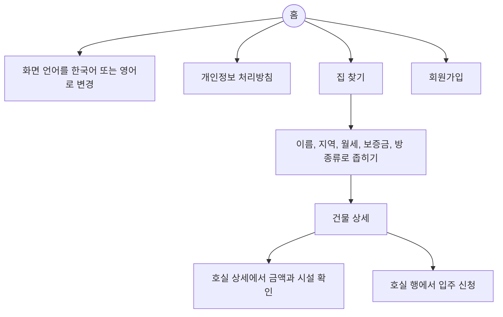

## 고객 지원

로그인하지 않은 사용자는 FAQ와 비회원 문의만 연다.
로그인한 비입주자와 관리자는 FAQ와 쪽지를 연다.
입주자는 FAQ, 쪽지, 채팅을 연다. 채팅 내용은 [커뮤니티](#커뮤니티)로 이어진다.

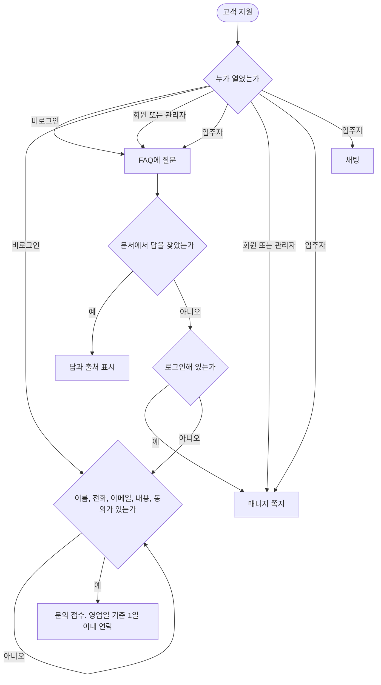

## 계정

이메일 가입 계정은 메일의 인증 링크를 누르기 전에는 로그인되지 않는다.
구글과 네이버는 인증 메일 없이 로그인된다.

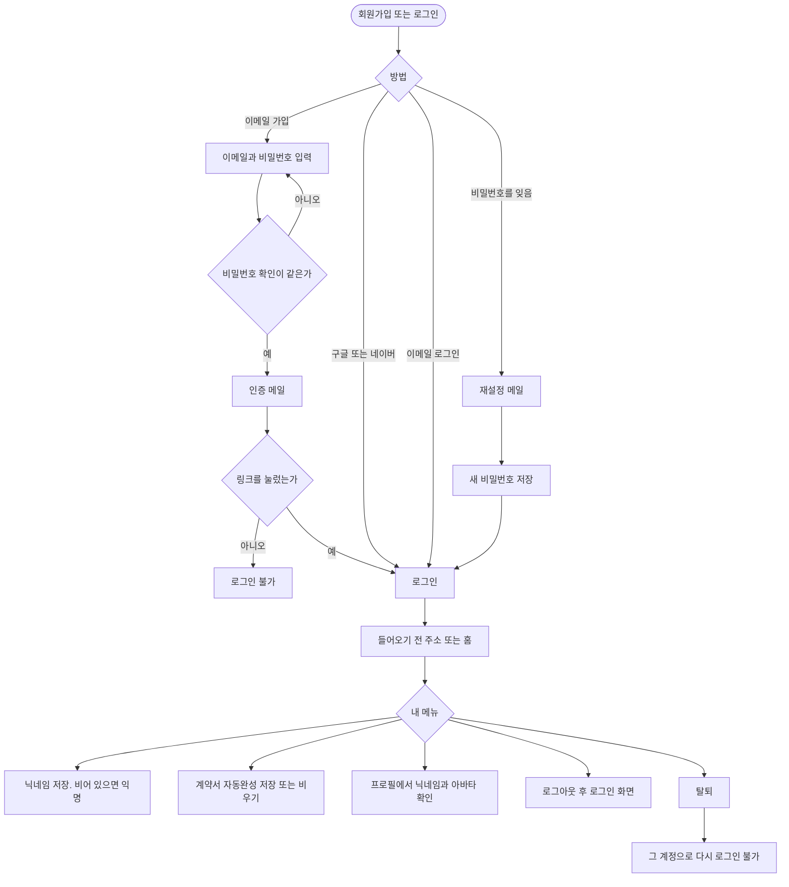

## 입주와 계약

로그인한 회원이 진행한다. 첫 결제 금액은 첫 달 이용료와 보증금이다.
같은 회원의 같은 호실에 기한 안인 작성 중 신청이 있으면 새로 만들지 않고 기간만 고친다.
작성 중은 2일, 승인 후 결제는 1일이 지나면 기한 만료가 된다.
퇴실 신청과 계약 종료는 상태 이름만 있고 사용자가 누르는 절차가 없어서 이 흐름에 넣지 않았다.

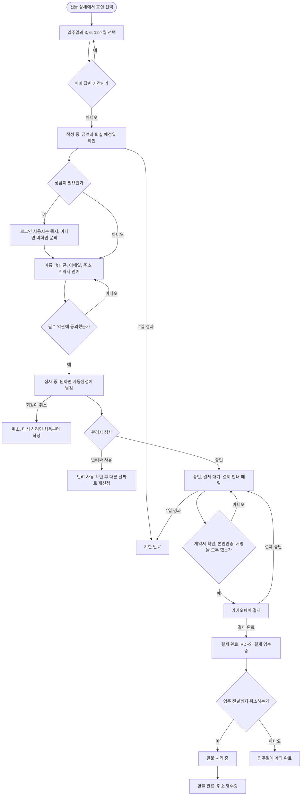

## 커뮤니티

헤더에 커뮤니티가 보여도 게시판은 입주자와 관리자만 연다.
관리자의 공지 작성은 회원 웹 커뮤니티에서 한다.
이용 제한 중에는 글을 쓸 수 없고 조회만 된다.
차단은 상대에게 알리지 않으며, 관리자 공지와 매니저 쪽지는 계속 받는다.

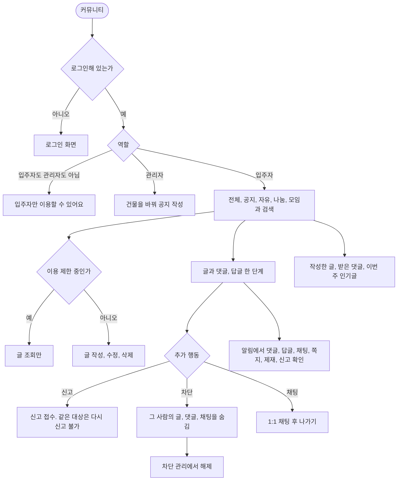

## 공용 자원 예약

신청이 끝나면 바로 예약 확정이고 QR이 발급된다. 관리자 승인 대기는 없다.
취소는 시작 시각 전, 연장은 종료 시각 전, 반납은 시작 시각 이후에 할 수 있다.
연장은 예약당 한 번이고 다음 예약이 있으면 되지 않는다.
시작 시각부터 30분 안에 체크인하지 않으면 예약은 취소된다.
공간은 종료 시각이 지나면 이용 만료가 되고, 물품은 그때까지 반납하지 않으면 연체가 된다.

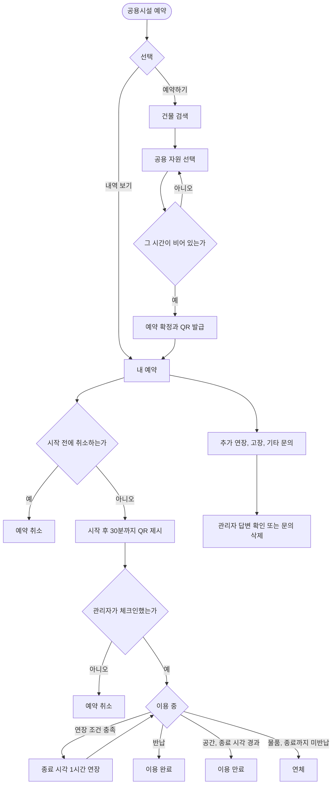

## 계약 심사

심사 중일 때만 승인과 반려가 된다.

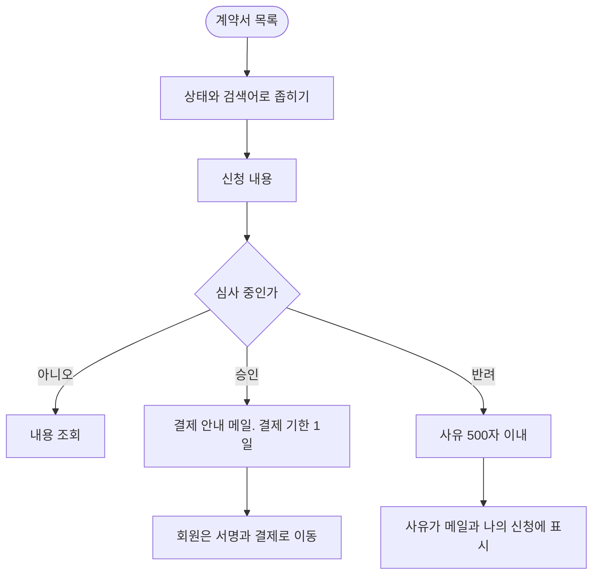

## 문서 양식

양식을 만든 뒤 건물 수정 화면에서 언어별 계약서 양식으로 그 건물에 등록한다. 이미 발급된 계약서는 바뀌지 않는다.

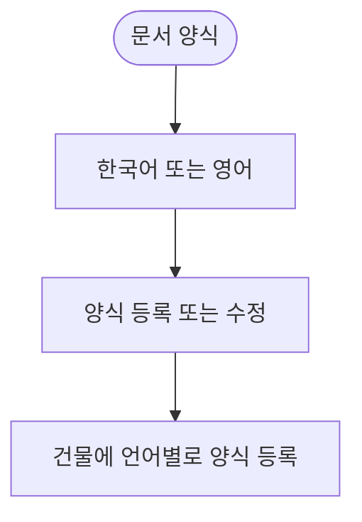

## 커뮤니티 운영

비회원 문의에는 답장 칸이 없다.
신고만으로 글이 숨겨지지는 않고, 관리자가 조치를 고른 뒤에 바뀐다.

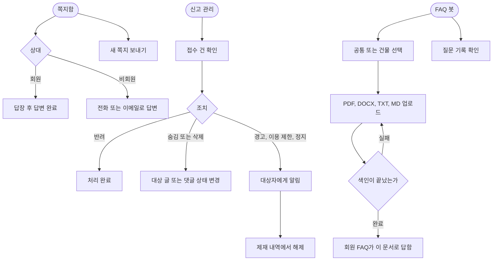

## 매물 관리

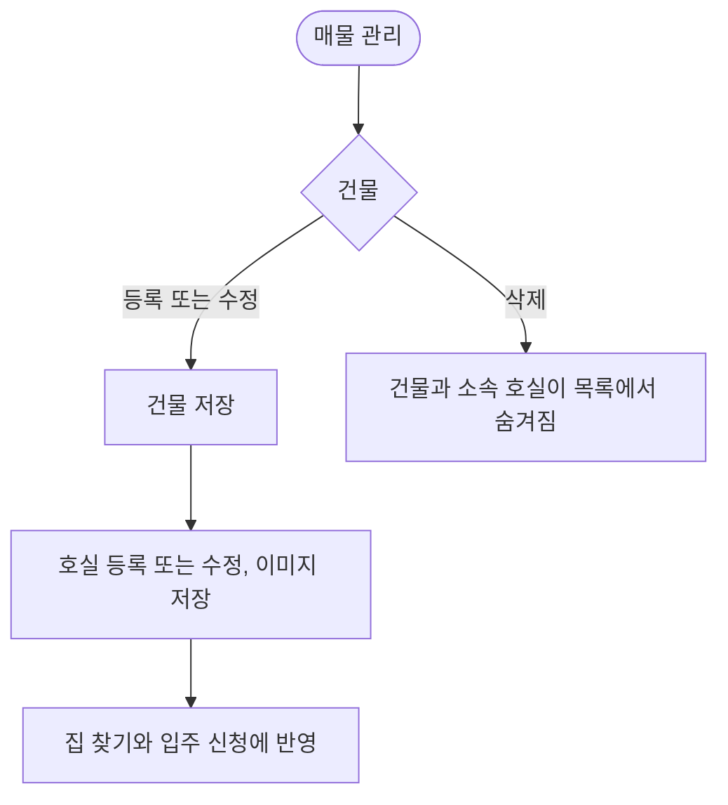

## 공용 자원 운영

예약 관리에서는 조회만 한다. 승인 버튼은 없다.
사용자 예약이 예약 확정이 된 뒤의 체크인, 연체, 문의 답변이 이 목적이다.

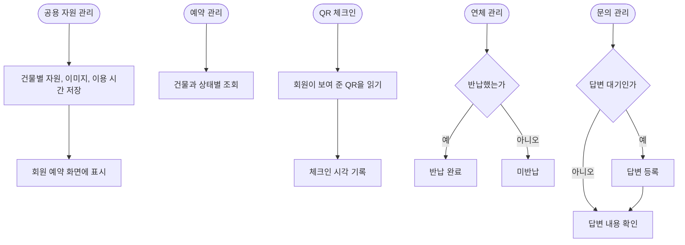

## 운영 현황 조회

숫자를 바꾸는 화면은 아니다. 건물과 월을 고르면 그 시점의 운영 숫자를 본다.

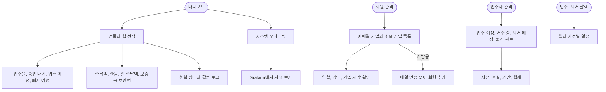
